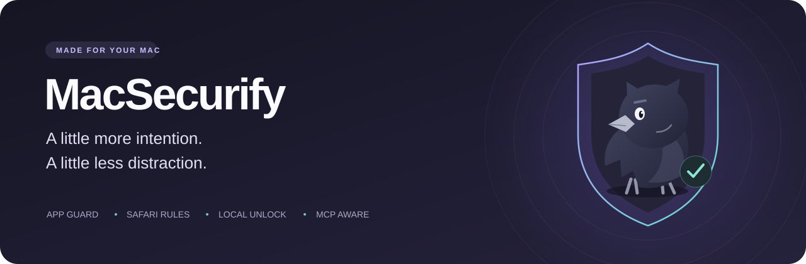
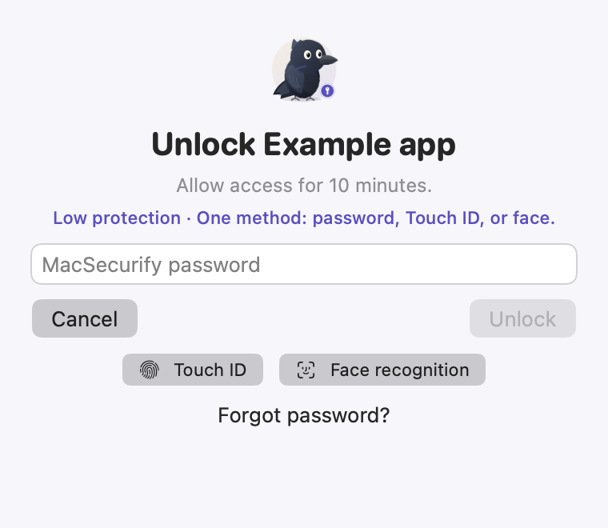
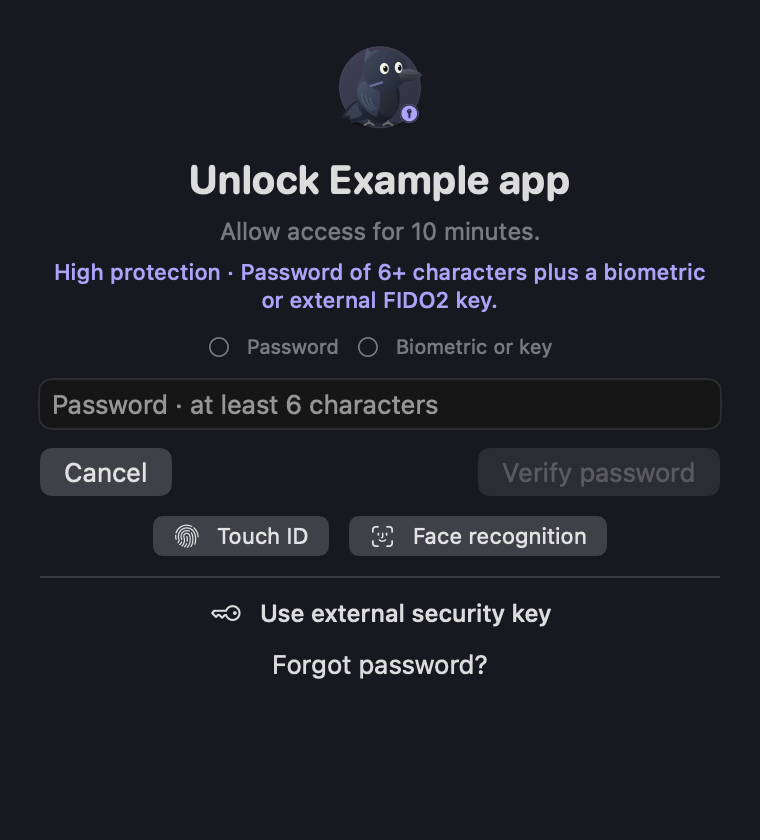
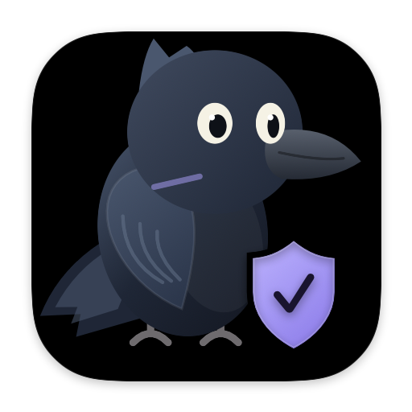

  

  <strong>A little privacy. A lot of peace of mind.</strong> 
  Protect selected Mac apps and Safari websites with a local authentication step.

  
  

macOS 13+ · Apple silicon · Password · Touch ID · Optional face recognition & USB security keys

> **Preview distribution:** this build is development signed and is **not Apple notarized**. macOS may block it on another Mac. Read the [installation notes](docs/INSTALL.md) before downloading. This repository contains the app downloads and documentation; the application source project is not included.

## Meet your privacy guard

Choose the applications and websites you want to keep personal. MacSecurify asks you to authenticate when you open a protected app, then grants access for the duration you choose. The Crow keeps watch from your menu bar when you close the main window.

| Feature | What you get |
| --- | --- |
| **Application protection** | A dedicated authentication prompt when you open a selected app. Already-running apps stay responsive. |
| **Safari website blocking** | Domain and subdomain rules, guided extension setup, and a clear **Unlock → authenticate → reload** flow. |
| **Your choice of authentication** | App password, macOS Touch ID, optional local webcam recognition, and external USB FIDO2 keys at High protection. |
| **Timed sessions** | Choose 1–60 minutes of access, or end active sessions with **Lock all now**. |
| **Local face setup** | Guided head movement, temporary landmarks, automatic framing, and local identity/liveness checks. Face verification has no webcam preview. |
| **Agent MCP connection** | Let cooperating agents check your restrictions and request a supported, narrowly scoped action through native review. |

Preview the compact authentication window

  
  

Interface previews use synthetic example data.

## Choose a protection level for each app

| Level | Required to unlock |
| --- | --- |
| **Low** | One available authentication method. |
| **Medium** | Your password **and** Touch ID or an enrolled face. |
| **High** | A password of at least six characters **and** a biometric or an enrolled external USB FIDO2 key. |

Management actions that can weaken protection respect the strongest configured app level. Webcam recognition is optional and is not Apple Face ID. Hardware Touch ID remains mandatory for approving an MCP access capability.

## Start in a few steps

1. Download **MacSecurify-1.6.4-macOS-arm64.dmg** from the [latest release](https://github.com/DeMisterio/MacSecurify/releases/latest). A ZIP containing the signed `.app` is available too.
2. Open the DMG, drag **MacSecurify** to **Applications**, and launch it from there.
3. Review the [Privacy Policy](PRIVACY.md) and [Terms of Use](TERMS.md), acknowledge both, then create your app password.
4. Add applications in **Applications**. Add domains in **Websites** and follow **Setup & help** to enable the Safari extension.
5. In **Security**, choose your access duration and optional unlock methods. Agent setup is at the bottom of that page.

Safari shows its standard content-blocker page when a site is blocked; an automatic in-browser unlock screen is not included. To open the site, choose **MacSecurify → Websites → Unlock**, authenticate, and reload the Safari tab. Closing the app window keeps protection running; quitting normally requires authentication.

**Updating?** Quit the previous copy normally before replacing it. Keep one installed copy and retain your existing Application Support and Keychain data. [Install and upgrade guide →](docs/INSTALL.md)

## Connect a cooperating agent

MCP gives an agent a way to ask MacSecurify what is protected, understand why an action is refused, and request a supported action. It does not force every agent to cooperate or turn MacSecurify into a system sandbox.

Open **Security → Agent MCP** for an illustrated, step-by-step connection guide. ChatGPT Desktop uses its MCP settings; the optional Terminal route uses the full installed CLI path, so no `codex` alias is needed. The bundled helper runs locally over standard input/output; it needs no provider API key or separate runtime. See the [MCP guide](docs/MCP.md) for Claude Desktop, Claude Code, Codex, ChatGPT compatibility and generic client configuration.

Exceptions start disabled. A supported approval grants a bounded, credential-free **HTTPS GET to one exact origin** through MacSecurify. It does not unlock a browser or application. You must review the request in the native app and approve with hardware Touch ID.

## Your data stays under your control

Basic app and website protection needs no account or publisher-operated cloud service. Password verifiers and enrolled face templates are stored in your Mac’s login Keychain. Touch ID stays with macOS. Camera frames are processed in memory and discarded. Optional face and security-key runtimes download third-party dependencies separately.

Face setup uses Apple Vision tracking built into macOS, and InsightFace identity/liveness models, which are installed once with a single command from the app. The optional pretrained InsightFace models have **non-commercial research restrictions** and are not included in the download. Review their terms before enabling them. [Face setup and recovery →](docs/FACE-AND-RECOVERY.md)

## Understand the protection boundary

MacSecurify is intended to discourage casual physical access to your logged-in Mac. It must be running, and it does not protect against hacker attacks, malware, administrator control, `kill -9`, deliberate force termination or changes to the software. Locked apps continue background work, and their content can briefly appear during activation. Safari protection covers new requests in Safari; existing content, caches, other browsers and Safari’s own blocker controls remain outside it. **Safari’s “Reload Without Content Blockers” bypasses website blocking without MacSecurify authentication.**

A crash or forced quit during temporary website access can leave the site allowed until MacSecurify restarts. Normal quit attempts to restore website locks. Read [SECURITY.md](SECURITY.md) and the [Terms of Use](TERMS.md) before relying on the app.

## Help & release information

- [Download the latest version](https://github.com/DeMisterio/MacSecurify/releases/latest) · [Changelog](CHANGELOG.md)
- [Installation](docs/INSTALL.md) · [Face recognition and recovery](docs/FACE-AND-RECOVERY.md) · [Agent MCP](docs/MCP.md)
- [Privacy Policy](PRIVACY.md) · [Terms of Use](TERMS.md) · [Security boundaries](SECURITY.md)
- [Report a bug](https://github.com/DeMisterio/MacSecurify/issues) or contact **lorsandjase@gmail.com**

Include your app/macOS versions and reproduction steps in a bug report. Keep passwords, biometric data, private URLs and personal file paths out of public issues.

 Published by Dmisterio

